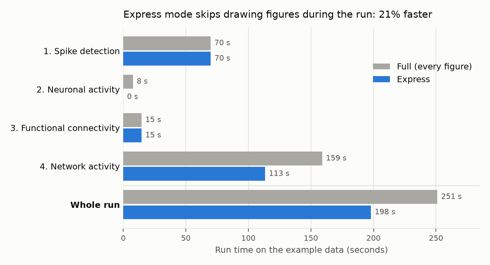

# MEA-NAP now runs faster

*19 November 2026 · MEA-NAP 1.50.0*

*Run times on the [example data](../python/express-mode.md#what-it-costs-and-what-it-saves),
with every figure drawn (Full) and with express mode.*

With the release of MEA-NAP in Python, we introduced a new way of running
MEA-NAP that we call **express mode**. In classic MEA-NAP, analyses and plots
are generated and saved to individual files in a folder structure. But we
realised that this often takes a lot of time, and makes it hard to share runs
with others. With express mode, we now save the analyses into a single file
(a `.meanap` file), and you view the plots in the MEA-NAP GUI.

This not only saves the time spent generating plots you may not find useful,
but also lets future plotting updates apply to older MEA-NAP runs, and makes it
easier to share a run: just send this one file. We hope you enjoy it!

You can still get every plot as a file: open the run in the results viewer and
press **Export figures…**, which draws the plots you choose (or all of them)
into a results folder, as PNG, SVG or PDF. To go back to drawing every plot during the
run, untick **Express mode** under **Other settings → Pipeline steps and
output**. See [Express mode and run bundles](../python/express-mode.md) for the
details.

*Tim, on behalf of the MEA-NAP team*
