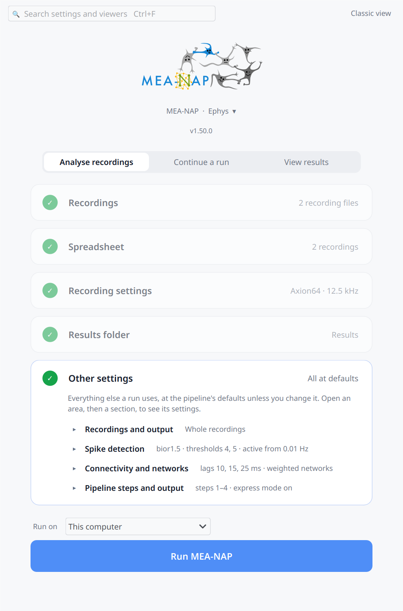
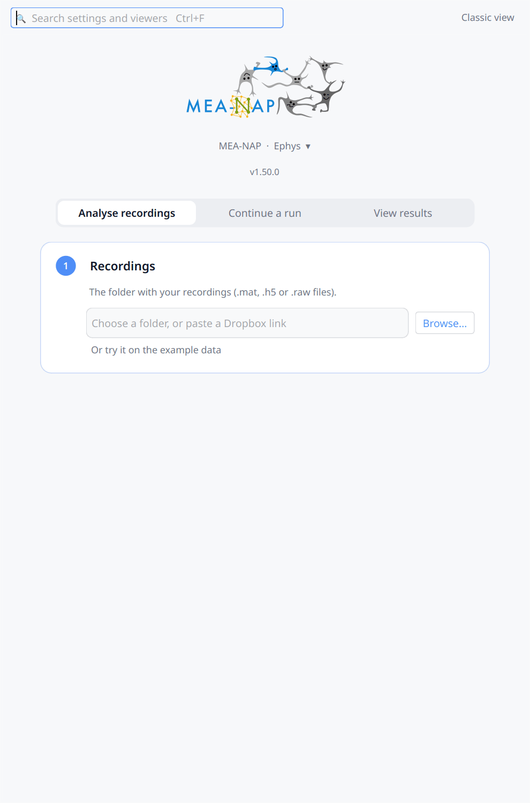
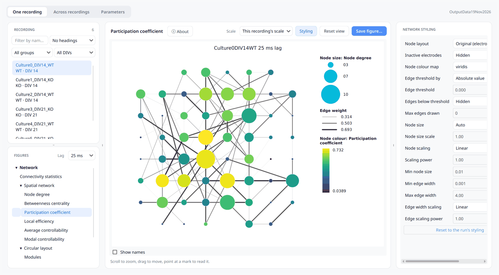

# A simpler MEA-NAP: the new default view

*19 November 2026 · MEA-NAP 1.50.0*

We released the [Python beta](2026-10-20-python-beta.md) a month ago. Today we
are excited to release a redesigned GUI for running MEA-NAP and viewing its
results. We hope it will make it much easier for new users to get started, and
bring some new features to our current users. If you prefer the previous GUI,
you can still switch back to it by clicking **Classic view** at the top right
of MEA-NAP.

*The new MEA-NAP GUI!*

## A more step-by-step approach to running MEA-NAP

In this new GUI, we first ask you for the key information needed for a MEA-NAP
run, starting with:

1. the location of your recording files;
2. a spreadsheet with information about your recordings (MEA-NAP now provides
   a helper to create the spreadsheet as well);
3. where you want to save the results;
4. and finally, other analysis-specific parameters you may want to tweak.

When you run MEA-NAP, we now also give more timely updates about which step
your run is in, and we will continue to improve the estimates of how long a
run takes.

## A search bar!

You can now search for settings and features within MEA-NAP, either by
clicking the search bar at the top left or by pressing **Ctrl+F**. The search
is fuzzy, so typing "spike detection" also brings up the wavelet parameters
used for spike detection.

## A new MEA-NAP viewer

*Selecting a node to see its connections, then laying the network out by its
connections (Styling → Node layout → Spring).*

With this new interface, all the plots MEA-NAP makes are drawn in a window of
the app. This allows quick interaction with the plots, such as adjusting how
your network is laid out spatially and which edges are included. You can still
export all of these plots to a folder, as PNG, SVG or PDF files, as in the
original MEA-NAP.

## Trying it

Already using the Python version? Update from the version line under the logo.
New to it: see [Installation](../python/installation.md), then the
[Quickstart](../python/quickstart.md). We would love to hear what works and
what doesn't: open an
[issue or a discussion](https://github.com/SAND-Lab/MEA-NAP/discussions) on
GitHub.

*Tim, on behalf of the MEA-NAP team*
