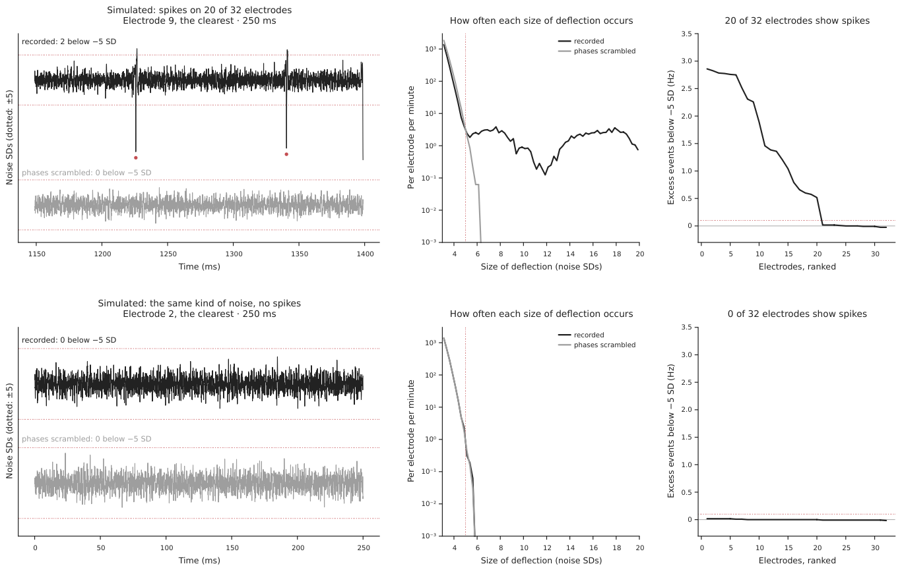

# Signal quality: are there spikes at all?

A spike detector or spike sorter always returns *something*. With the threshold
low enough, noise crosses it tens of times a second on every electrode. The
sorter's quality metrics (SNR, refractory violations, isolation) then describe
those crossings, not whether a neuron made them. Before step 1 detects
anything, MEA-NAP asks the prior question from the voltage alone: **does this
recording contain more large deflections than its own noise can produce?**

The check is on by default (Spike detection tab → *Signal quality check*). It
reads one minute of each recording and writes
`1_SpikeDetection/1C_SignalQuality/`.

## How it works

Spikes are brief, large and rare, so a trace that contains them has heavier
tails than noise with the same power spectrum. For each electrode MEA-NAP

1. filters the trace with the detection bandpass and measures its noise SD
   (median absolute deviation / 0.6745, as the threshold detector does);
2. makes **phase-randomised surrogates**: the same amplitude spectrum with
   the Fourier phases scrambled. A surrogate has exactly this electrode's
   noise (its level, its colour, any line noise) and nothing time-locked, so
   no spikes;
3. counts local extrema beyond 4, 5 and 6 SD in the trace and in the
   surrogates, negative and positive separately.

An electrode **shows spikes** when it has significantly more *negative-going*
extrema beyond 5 SD than its surrogates (one-sided Poisson test, p < 0.001)
and at least 0.1 more per second. Extracellular spikes are negative-going at
the nearest electrode. An electrode whose excess is only positive-going is
reported separately: that is usually artifact, though some units are
positive-going.

A Gaussian reference with one spectrum for the whole recording is not enough.
Electrodes differ in noise level and colour, so their extreme-value rates
differ, and a single reference flags noisy electrodes as spiking. Each
electrode's own surrogate avoids that.

## The figure

One figure per recording, three panels:

- **Left:** 250 ms of the electrode with the clearest spikes (blue) above the same 250 ms
  of its surrogate (grey), both in noise SDs, with ±5 SD dotted and every
  event beyond −5 SD marked ▲. The grey trace is what
  the electrode would look like if it held only noise.
- **Middle:** how often each size of deflection occurs per electrode per
  minute, recorded against surrogate. Spikes are the blue tail that the grey
  curve lacks.
- **Right:** the negative excess beyond 5 SD on every electrode, ranked.



In the example above, the top recording has spikes: its tail of large
deflections runs far past what its own noise produces, on most electrodes. The
bottom one is noise with the same spectrum. A detector run on it at a low
threshold would still report spikes on every electrode, and a sorter would
still return units.

## Reading the output

- `signal_quality_summary.csv`: one row per recording, with the number of
  electrodes showing spikes, the number with positive-only excess, the ratio
  of recorded to surrogate deflections beyond 5 SD, and the verdict.
- `<recording>_signal_quality.csv`: one row per electrode, with the noise SD,
  counts beyond each threshold (negative and positive), the surrogate's
  expectation, the excess rates, the p-value and the flags.
- The run log prints the verdict for each recording, marked `!` when no
  electrode shows spikes.
- The results viewer lists the figure first under each recording's *Spike
  detection checks* as **Signal quality**, says above the figure list how many
  electrodes show spikes, and marks a recording with none "⚠ no spikes" in the
  recording list. The simple view says so when the run finishes.

## What it can and cannot tell you

- **A recording where no electrode shows spikes is noise as far as threshold
  detection or spike sorting can tell.** Spikes or units from it, and the
  networks built on them, describe noise. Lowering the threshold or changing
  the sorter does not change that.
- It sees spikes larger than about 5 noise SDs. Smaller spikes may exist,
  but no threshold-based method can tell them from noise either.
- A few electrodes with a weak excess can be a handful of real, sparse cells
  or a few faulty electrodes. Look at the
  per-electrode CSV: an electrode that recurs across recordings of the same
  preparation, with negative-going events, is the better candidate for a cell.
- The verdict is about the minute it read, from 5 s in. Very sparse or
  intermittent activity may need a longer window (*Seconds checked*).
- It does not replace sorter curation. A recording that passes still needs its
  units or detections checked.

## Cost

The check reads at most *Seconds checked* (default 60 s). It takes about 15 s
on a 60-electrode MCS recording and about a minute on a 1,000-electrode
recording, on up to 8 threads (fewer when free memory is short; each holds about
1.5 GB on a minute of 20 kHz data). Detection then runs as before.

## Using it from Python

```python
from meanap.pipeline.io import load_raw_recording
from meanap.pipeline.signal_quality import assess_signal_quality, plot_signal_quality

dat, channels, fs = load_raw_recording("recording.mat")
res = assess_signal_quality(dat, fs, channels, band=(600, 8000), max_seconds=60)
print(res.summary()["verdict"])
res.to_frame().to_csv("per_electrode.csv", index=False)
plot_signal_quality(res, "signal_quality.png", title="recording")
```
