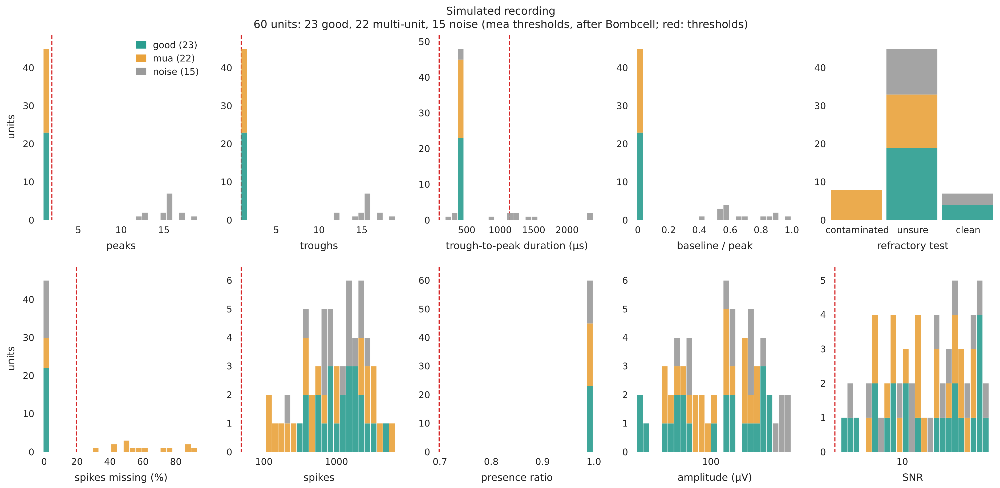

# Unit quality: are the sorted units neurons?

A spike sorter always returns units, and its labels (or none) are its own
opinion of them. When MEA-NAP imports a sorting ([Importing sorted
data](sorted-import.md)), it scores every unit on a common set of quality
metrics and labels it **good**, **mua** (multi-unit activity) or **noise**,
so imports from different sorters and labs are judged the same way.

The metrics and the way they combine follow
[Bombcell](https://github.com/Julie-Fabre/bombcell), the automated curation
tool by Julie Fabre and colleagues:

> Julie M.J. Fabre, Enny H. van Beest, Andrew J. Peters, Matteo Carandini,
> & Kenneth D. Harris. (2023). Bombcell: automated curation and cell
> classification of spike-sorted electrophysiology data. Zenodo.
> <https://doi.org/10.5281/zenodo.8172821>

If you use these labels in a paper, cite Bombcell for the method. MEA-NAP's
version is an independent implementation of the published criteria, not
Bombcell's code. It adds a threshold preset for planar MEAs (below), so its
labels will not match Bombcell's exactly.

The scores are a **report**: which units become network nodes is still
decided by the sorter's labels and *Leave out labels* (by default, units the
sorter called noise). The table says which units those were.

## The criteria

A unit is labelled in Bombcell's order. A unit failing any **noise**
criterion is noise; otherwise one failing any **mua** criterion is
multi-unit; the rest are good.

| Criterion | Measures | Fails when | Needs |
|---|---|---|---|
| peaks / troughs | local maxima and minima of the template, at ≥ 20 % of its size | > 2 peaks or > 1 trough | template |
| duration | trough to the larger peak | < 100 µs or > 1150 µs | template |
| second peak | peak after the trough ÷ trough | > 0.8 | template |
| baseline | largest value before the spike ÷ largest overall | > 0.3 (**bombcell** preset only) | template |
| spatial decay | how fast amplitude falls with distance from the peak electrode | outside 0.01–0.1 /µm, dense probes only | multi-channel template |
| refractory | the sliding refractory-period test (below) | confidently > 10 % contamination | spike times |
| missing spikes | Gaussian fit to the amplitude distribution, the share cut off below detection | > 20 % | per-spike amplitudes |
| spike count | — | < 300 (**bombcell**) or < 50 (**mea**) | spike times |
| firing rate | — | < 0.05 Hz (**mea** only) | spike times |
| presence ratio | share of 60 s bins the unit fires in | < 0.7 | spike times |
| amplitude | template peak to trough, µV | < 40 µV (**bombcell** only) | template in µV |
| SNR | template's largest absolute value ÷ the channel's noise level | < 5 | template in µV + noise levels |

Each unit also gets a **non-somatic** flag, as Bombcell reports it: a waveform
whose positive peak is larger than its trough, or whose trough is narrow
between two peaks, as an axon's is. It does not change the label.

A criterion the import cannot measure is left blank and does not count against
a unit. A SpikeInterface `SortingAnalyzer` with `templates`, `noise_levels`
and `spike_amplitudes` computed supports every criterion. Phy/Kilosort and
SpyKING CIRCUS output carries templates in the sorter's own units (whitened,
normalised), so their units are not tested on amplitude or SNR.

### The refractory test

A neuron cannot fire twice within its refractory period, so spikes that close
together come from another neuron. How many such pairs to expect depends on
the firing rate and the recording's length. The **sliding refractory-period
test** (the International Brain Laboratory's metric, Bombcell's default)
works out, for refractory periods from 1 to 10 ms, how confident one can be
that the unit's contamination is under a given level. A unit is:

- **clean** if, for some refractory period, it is confidently (90 %) under
  10 % contamination;
- **contaminated** if it is confidently over 10 % at every refractory period;
- **unsure** otherwise. That means too few spikes: a unit firing 0.3 times
  a second for five minutes has about 90 spikes, and even with no violations
  at all that is not enough to rule out 10 % contamination.

Under the **bombcell** preset, "unsure" fails, as it does in Bombcell by
default. Under the **mea** preset, it passes (Bombcell's
`keepUncertainRPVUnits` option). Otherwise nothing on a short MEA recording
could be good. The figure shows how many units fell in each of the three
groups, so a "good" unit that was "unsure" can be told from one that was
cleared.

Hill, Mehta & Kleinfeld (2011)'s closed-form contamination estimate at a
2 ms refractory period, Bombcell's older method, is available too
(`QualityThresholds(refractory_method="hill")`).

## Presets

`mea` is MEA-NAP's default. `bombcell` is Bombcell's own defaults, which were
tuned on hour-long Neuropixels recordings sorted with Kilosort. `mea` differs
in three ways, each because a planar MEA's data breaks an assumption:

- **No baseline-flatness test.** An MEA spike's template rises in a broad
  positive phase from about 1 ms before its trough. On real hippocampal
  cultures, that alone labels clean, high-SNR spikes as noise.
- **A floor of 50 spikes and 0.05 Hz, not 300 spikes.** MEA recordings are
  minutes long, not hours.
- **No absolute amplitude floor.** SNR ≥ 5 already sets one relative to each
  electrode's noise, and µV levels differ between MEA types.
- **Refractory "unsure" passes** (above).

## The figure

**Spike sorting checks → Unit quality metrics** in the
results viewer. It has one histogram per criterion, stacked by the label each
unit got, with the thresholds in red. A histogram shows a metric the import
supports; the title counts the labels.



The example is simulated: clean neurons, neurons contaminated by a second
one, neurons cut off at the detection threshold, and noise clusters with no
spike shape. The noise clusters fail on peaks, troughs and duration. The
contaminated units fail the refractory test, and the cut-off ones fail on
missing spikes.

## Output

`1_SpikeDetection/1D_UnitQuality/`, per recording:

- `<recording>_unit_quality.csv`: one row per unit the sorter returned, with
  every metric, `label`, `fails` (the criteria it failed), `non_somatic`,
  `kept` (whether it became a network node) and the sorter's own label;
- `<recording>_unit_quality.json`: the preset and thresholds used;
- `<recording>_4_UnitQualityMetrics.png`: the figure.

The log gives each recording's count, e.g.
`unit quality (mea thresholds, after Bombcell): 24 good, 270 multi-unit, 50 noise of 344`.

## Using it from Python

```python
from meanap.pipeline.unit_quality import (
    compute_unit_quality, inputs_from_analyzer, plot_unit_quality,
)

inputs = inputs_from_analyzer("path/to/sorting_analyzer")
units = compute_unit_quality(inputs, "mea")          # or "bombcell"
print(units.label.value_counts())
units.to_csv("units.csv", index=False)
plot_unit_quality(units, "units.png", thresholds="mea", amplitude_in_uv=inputs.in_uv)
```

## Against the electrode's own noise (raw voltage)

A sorter run on noise still returns units. It picks the times the noise
peaked and clusters them, and the result can pass every criterion above: the
sorter enforces a refractory gap, and an average of noise troughs *is* a
trough. When the raw recording the sorting was made from is next to it (a
MaxWell `.raw.h5`, found in the raw or sorted data folder or beside the sorter
output), MEA-NAP also asks the question only the voltage can answer: **could
this electrode's noise alone have made spikes this large this often?**

For each unit, on its peak electrode, over the first 2 minutes:

1. The trace is band-passed at 300–6000 Hz (the band sorters use) and scaled
   by its noise level (MAD / 0.6745).
2. Each spike's size is the extreme value, in the direction of the unit's mean
   waveform, within ±0.5 ms of its time. The median is the unit's **raw SNR**
   (`raw_snr`; `raw_amp_uv` in µV).
3. The same filtered trace, with its Fourier phases scrambled (the same noise
   level and spectrum, with nothing time-locked), is searched for events at
   least that large, 1 ms apart: how many per second noise alone makes
   (`noise_rate_hz`).
4. **`noise_fraction`** = that rate ÷ the unit's own rate of spikes at least
   that large (`unit_rate_hz`). Roughly: the share of the unit's large spikes
   the noise could account for. `noise_p` is the Poisson chance of the unit's
   count if noise were all there was.

A unit with `noise_fraction` ≥ 0.5 fails **noise-like** and is labelled
**noise**. The comparison is against noise *peaks*, not noise at random
times, because the sorter chose the spike times for being peaks. A
random-time comparison would pass a pure-noise unit. The surrogate keeps the
power of any real spikes on the electrode, so it errs towards calling a unit
noise-like, never towards passing it.

It runs when **Check for spikes first** (`signal_quality_check`, on by
default) is on, and needs MaxWell's decompression plugin (see
[MaxWell recordings](gui-guide.md#maxwell-recordings)). A unit whose electrode is
not in the raw file, or with fewer than 10 spikes in the window, is left
blank. The raw file must be the recording that was sorted. A sort of another
recording on the same routing would be scored against the wrong voltage.

**Figure: Units against their electrode's noise.** Three example units, one
per column: the clearest (highest raw SNR), the one closest to the cutoff, and
a typical noise-like one. On top are 60 of each unit's raw spikes and their
mean, in noise SDs. Below are two curves: how often the unit's spikes reach
each size, and how often its electrode's noise alone does (dashed). Where the
dashed curve is above the unit's at the red line (the unit's median spike
size), noise alone could make the unit's spikes. A unit whose curve stays
above the noise's only in its tail has a few spikes too large for noise among
many that are not.

Because it compares a unit with the noise on its own electrode, the verdict
follows the unit's SNR: on a single electrode, units below an SNR of about
3–4 usually fail it, and units above 5 almost never do.

## What it can and cannot tell you

- **A good label is not proof of one neuron.** On a sparse array a unit is
  seen on one electrode, so nothing spatial separates two neurons with
  similar spikes. On a short recording, most good units are "unsure" on
  the refractory test.
- **A recording with no spikes gives no good units, but its units say little
  either.** Check [Signal quality](signal-quality.md) first: it asks whether
  the voltage holds spikes at all, before any sorter is involved.
- The labels do not change the network. To build networks from good units
  only, curate the sorting (in phy, or by the table's `unit_id`s) and import
  that.
