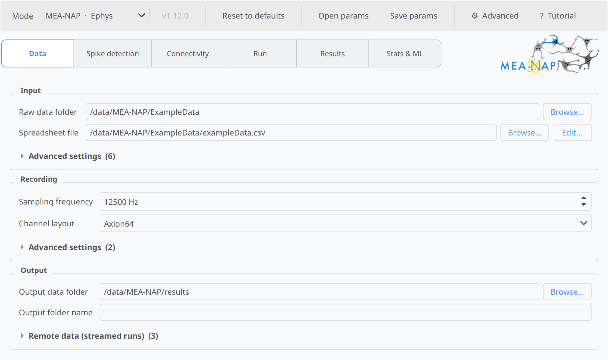
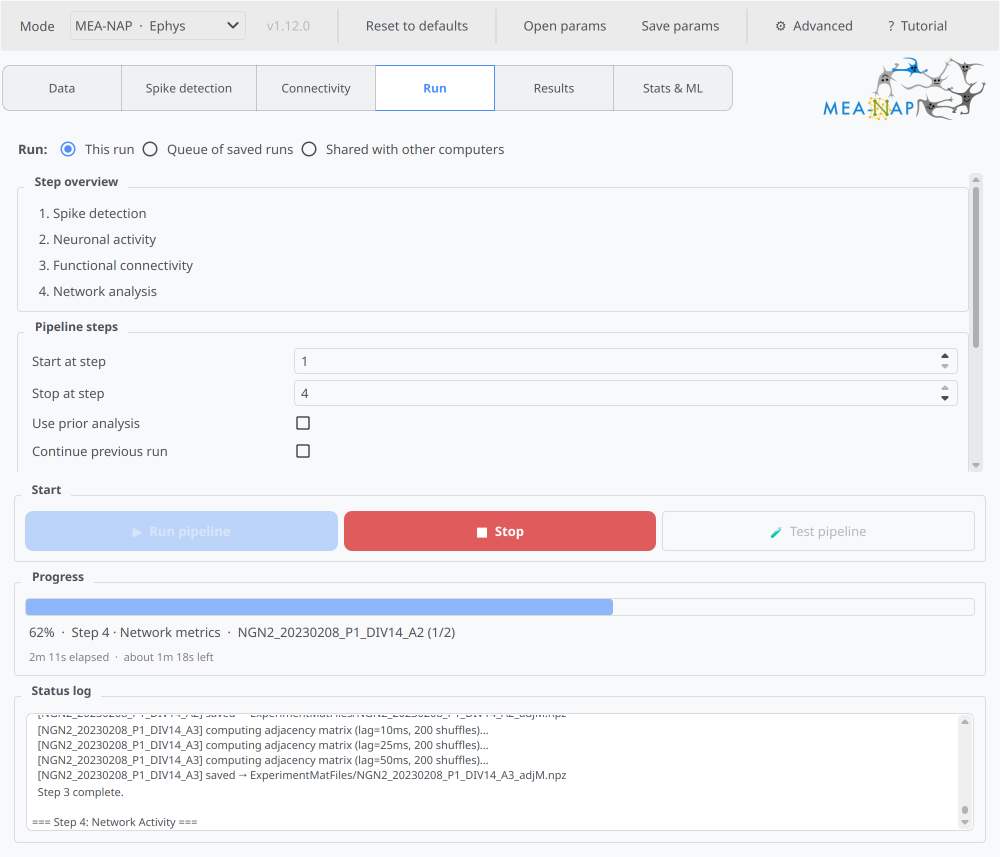
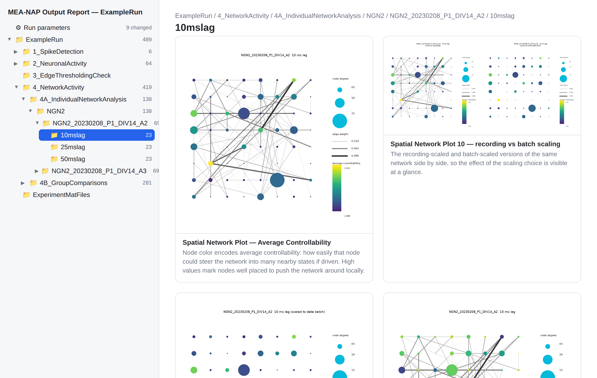
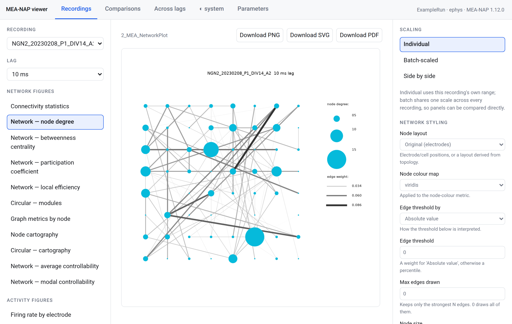

# MEA-NAP in Python: beta release


Hello! We are excited to release the python version of MEA-NAP and would like to invite 
you to try it out and give us feedback! 

This is a beta version release because we would like to get more feedback on it before making it a 'paper-ready' version, but we have been testing it within the lab for the past few months and are pretty confident about it and so would like to make it more accessible to everyone!

Full documentation on how to install and use the python version of MEA-NAP is [here](https://analysis-pipeline.readthedocs.io/en/latest/python/index.html)


*Setting up a run in the MEA-NAP Python GUI*


*A run in progress, with an estimate of the time left*


## What's new in the python version?

The python version offers a bunch of feature enhancements and new features, broadly: 

Run time and output

- Overall 3X speed up over the MATLAB version
- More compact saving of MEA-NAP outputs into a single file 
- Progress bar for a rough estimate of how long the pipeline run will take 
- Ability to stream data from remote data source (eg. Dropbox)
- You can now split runs across multiple computers 
- A run can be resumed if it is interrupted
- Axion raw files can now be read directly instead of going through a conversion step

Spike-sorting support:

- Spike-sorted output, especially from platforms such as phy/Kilosort, SpikeInterface, spyking circus, is now more readily supported and can be used in place of the provided spike detection step
- We also now provide a wrapper that performs spike-sorting through SpikeInterface

Analysis

- A more complete statistics and machine-learning step to perform statistical comparison and classification / regression analysis across age, genotype and other group effects 
- It is now possible to add or remove recordings from a pipeline run without having to re-do the entire pipeline (assuming you are still using the same recording parameters)
- You can now run the pipeline with a fixed random seed to ensure reproducibility of the output. This applies to step involving some form of randomisation, such as the circular shift test for signifiance of correlation. 

Data visualisation 

- Interactive HTML report for viewing results and networks
- Spike and burst viewer for checking spike and burst detection 
- Since analysis and plotting is now separate processes in the python version of MEA-NAP, it is now much easier to create new visualisation from existing data without having to re-run the pipeline


*The HTML report: every figure of a run, organised by step and recording, with a description of each.*


*The network viewer: browse any recording's networks and figures, restyle them, and download them as PNG, SVG or PDF.*

Ease of use

- Tutorial mode to guide you through the different parts of the MEA-NAP gui
- Ability to run MEA-NAP from the command line
- MEA-NAP's gui now check for updates on github and allows you to update MEA-NAP within the GUI


## How it compares with the MATLAB version


Almost all the features that are currently in the MATLAB version are also in the Python version (see the [known gaps](https://github.com/SAND-Lab/MEA-NAP/blob/main/docs/python/matlab-vs-python.md#known-gaps)). We have performed tests to ensure that the analyses and plotting outputs are the same as the Matlab version (except in cases where we introduce new analyses and refine the plots). See [MATLAB vs Python](https://github.com/SAND-Lab/MEA-NAP/blob/main/docs/python/matlab-vs-python.md) for the full comparison.

## A note on LLM usage and beta release

The conversion of MEA-NAP from matlab to python would take way longer or may not even happen without the assistance of LLMs in the process. However, it may also raise issues with the interpretability of the code and analysis. Currently, the analysis provided by MEA-NAP were previously designed by the authors and we have and continue to work on ensuring that the python version provides a faithful port of the matlab version (See: [MATLAB vs Python comparison](https://github.com/SAND-Lab/MEA-NAP/blob/main/docs/python/matlab-vs-python.md)). As we introduce new features and analyses, we aim to make it so that the analyses remain transparent and interpretable. 

As a beta release, there will be some proportion of documentation, plot descriptions and other forms of text that requires further human review to make sure they are correct and easy to interpret. We will continue to work on this and make updates. 


## Is MATLAB going away?

The MATLAB version will continue to be supported, mainly in the form of troubleshooting, bug fixes and of course fixes to analyses if they are found to be faulty. But new features will very much focused on the Python version, with updates to MATLAB happening much less frequently. But do write to us / raise a discussion if you are using the MATLAB version of MEA-NAP and have a reason not to switch to the python version, the main point is to make MEA-NAP more accessible and powerful for everyone so it turns out most people prefer to use the MATLAB version we are very open to develop it more!

## Trying MEA-NAP in python 

From a terminal:

```bash
git clone https://github.com/SAND-Lab/MEA-NAP.git
cd MEA-NAP
uv sync              # or: python3 -m venv .venv && source .venv/bin/activate && pip install -e .
uv run meanap-gui    # or: meanap-gui
```

macOS users need a few build tools first (Homebrew, CMake, LLVM). See the [installation guide](https://github.com/SAND-Lab/MEA-NAP/blob/main/docs/python/installation.md). Then follow the [quickstart](https://github.com/SAND-Lab/MEA-NAP/blob/main/docs/python/quickstart.md).


## Feedback

Any feedback is very welcome, please open github issue / threads / email us about anything you want to see in MEA-NAP.

## Citing MEA-NAP

If you use MEA-NAP (Python or MATLAB), please cite:

Timothy PH Sit, Rachael C Feord, Alexander WE Dunn, Jeremi Chabros, David Oluigbo, Hugo H Smith, Lance Burn, Elise Chang, Alessio Boschi, Yin Yuan, George M Gibbons, Mahsa Khayat-Khoei, Francesco De Angelis, Erik Hemberg, Martin Hemberg, Madeline A Lancaster, Andras Lakatos, Stephen J Eglen, Ole Paulsen, Susanna B Mierau. **MEA-NAP: A flexible network analysis pipeline for neuronal 2D and 3D organoid multielectrode recordings.** Cell Reports Methods, 4, 100901, 2024. [doi:10.1016/j.crmeth.2024.100901](https://www.cell.com/cell-reports-methods/fulltext/S2667-2375(24)00291-1)

## Thanks

Thanks to members of the SAND group for testing out the python version of MEA-NAP!
A special shoutout to Sanjana and Ada for testing multiple versions of the python code. 