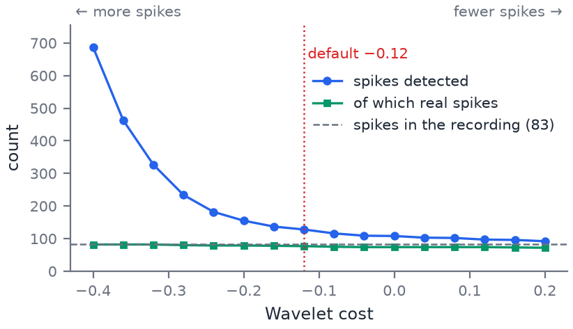

The wavelet detector looks for stretches of the filtered trace that have the shape of a spike, rather than for dips below a fixed voltage. **bior1.5** is MEA-NAP's default.

## What it does
A wavelet is a short wiggle with a set shape (the blue curves above). The detector slides it along the bandpass-filtered trace, stretched to five widths between 0.4 and 0.8 ms (the width range of a typical spike), and at each point measures how well the trace matches. A spike gives a large match; noise gives small, random ones. Detection then decides, scale by scale, which matches are large enough to be spikes, merges detections closer than about 0.6 ms, and moves each spike to the bottom of its trough.

**Wavelet methods** are the shapes to try. Select several to compare them: each is saved as its own result (`bior1p5`, `bior1p3`, `db2`, `sym2`, `haar`, `mea`), and **Spike method for analysis** picks the one steps 2–4 use.

- **bior1.5** and **bior1.3**: a sharp trough between two smaller peaks, close to the shape of an extracellular spike. bior1.3 is the shorter, plainer of the two.
- **db2** and **sym2**: lopsided wavelets, one the other turned round; they suit spikes whose rise and fall are not symmetrical.
- **haar**: a square step. It responds to any sudden change, so it is the least specific to spike shape.
- **mea**: a wavelet built from your data. On each electrode, the median spike a threshold detector finds is smoothed and turned into a wavelet, which then searches that electrode for spikes like it. The template settings say how the median spike is found.

**Wavelet cost** (default −0.12) tilts that decision. It sets how the Bayesian decision rule of Nenadic & Burdick weighs missed spikes against false ones: more negative values lower the bar and find more spikes; zero or positive values raise it and find fewer.

## Choosing a value
Keep bior1.5 and −0.12 unless the spike check figures show a problem. If small, real spikes are missed, try −0.2; if the detector picks up noise on quiet electrodes, try 0 or a little above. On the synthetic data above, lowering the cost mostly adds false detections. mea can follow an unusual spike shape more closely than the fixed wavelets, but it is only as good as the threshold spikes its template comes from.

## How MEA-NAP uses it
Step 1 runs every selected wavelet on every electrode and stores each result in the spike file. Only the method chosen in **Spike method for analysis** is used by steps 2–4. bior1.5, bior1.3, db2, sym2 and haar give the same spikes as MATLAB MEA-NAP, as does the mea template and wavelet.

## Things to watch for
- The cost applies to every selected wavelet.
- The width range (0.4–0.8 ms) and number of scales (5) are fixed, not settings.
- mea makes its own wavelet on each electrode, so its spikes are not comparable between electrodes in the way a fixed wavelet's are. An electrode with fewer than four threshold spikes gets no mea spikes.
- mea's narrowest scales differ from MATLAB's. MATLAB sometimes sets mea to look for 0.4 ms spikes with a wavelet only a few samples long, whose shape is lost. On some electrodes MATLAB stops with an error instead. MEA-NAP leaves those scales out.

## References
Nenadic Z, Burdick JW (2005). Spike detection using the continuous wavelet transform. *IEEE Trans Biomed Eng* 52(1):74–87.
